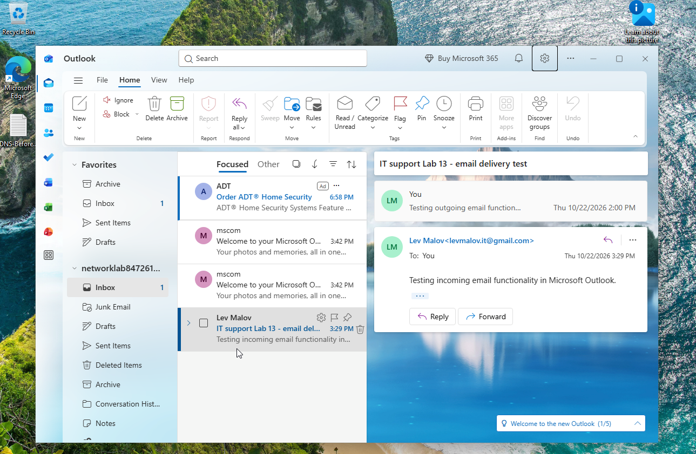
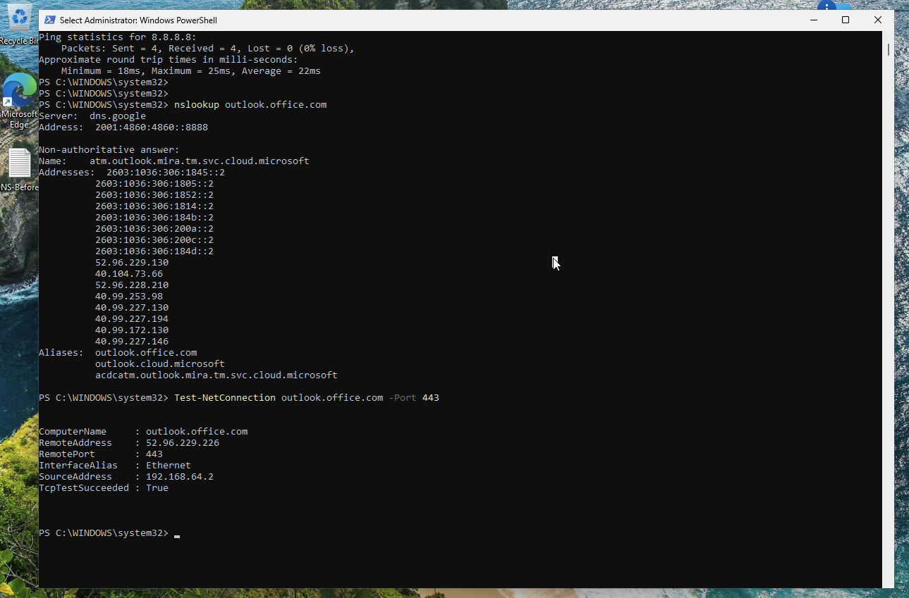

# Lab 13 — Microsoft Outlook Troubleshooting

## Objective
Practice entry-level IT support troubleshooting for New Outlook by verifying email delivery, diagnosing network and DNS connectivity, checking HTTPS reachability, and using Windows app repair.

## Environment
- Windows virtual machine running in UTM
- New Outlook with a personal Outlook.com test account
- Gmail account for external mail testing
- Windows PowerShell

## Scenario
A help desk technician is asked to investigate a report that Outlook may not be sending or receiving email. The goal is to verify email flow and rule out common connectivity and application issues. This was a **simulated troubleshooting exercise**; no persistent Outlook failure was reproduced.

## Procedure and Evidence

### 1. Verify outbound and inbound email
- Sent a test message from New Outlook to Gmail.
- Found the test message in Gmail's Spam folder and marked it as not spam.
- Replied from Gmail and verified that the reply appeared in New Outlook.

**Result:** Outbound and inbound email delivery confirmed.



### 2. Verify network, DNS, and HTTPS connectivity
Used PowerShell to run the following diagnostic commands:

```powershell
Get-NetAdapter | Format-Table Name, Status, LinkSpeed
ping 8.8.8.8
nslookup outlook.office.com
Test-NetConnection outlook.office.com -Port 443
```

**Observed results:**
- Ethernet adapter reported `Up` with a virtual link speed of `10 Gbps` (verified during the lab).
- Ping to `8.8.8.8`: four packets received, **0% loss**.
- `nslookup` returned IPv4 and IPv6 addresses for `outlook.office.com` using Google Public DNS.
- HTTPS TCP connectivity: `TcpTestSucceeded : True` on port `443`.

These tests confirm basic network reachability, DNS resolution, and TCP connectivity to the tested endpoint; they do not by themselves prove that all Outlook authentication or synchronization services are healthy.



### 3. Review Outlook application troubleshooting
- Investigated `outlook.exe /safe` and determined that this Classic Outlook method was not applicable to the installed **New Outlook** app.
- Opened **Windows Settings → Apps → Installed apps → Outlook (new) → Advanced options → Repair**.
- Ran **Repair** and reopened Outlook.
- Confirmed that the mailbox and test conversation remained accessible.
- Reviewed **Outlook Settings → Accounts → Your accounts**. No separate manual Sync Email setting was available for the personal Outlook.com account.

**Result:** New Outlook opened normally after Repair, with the email conversation intact. The repair was a practice step, not a confirmed fix for a reproduced fault.


## Help Desk Ticket Example

**Category:** Email / Outlook  
**Issue:** User reports possible difficulty sending or receiving Outlook messages.  
**Troubleshooting:** Tested outbound and inbound email; verified IP connectivity, DNS lookup, and TCP 443 reachability; reviewed app compatibility and performed Windows app Repair.  
**Resolution / outcome:** Email send/receive tests succeeded, and Outlook launched normally after Repair. No persistent issue reproduced.  
**Status:** Closed — functionality verified in lab environment.

## Skills Demonstrated
- Email delivery testing and spam-folder triage
- PowerShell network diagnostics
- DNS resolution and HTTPS TCP connectivity testing
- New Outlook vs. Classic Outlook troubleshooting differences
- Windows app repair and post-repair validation
- Help desk ticket documentation

## Conclusion
Successfully validated email flow and core network connectivity for New Outlook in a Windows VM, practiced the built-in app repair process, and documented the results using three screenshots.
