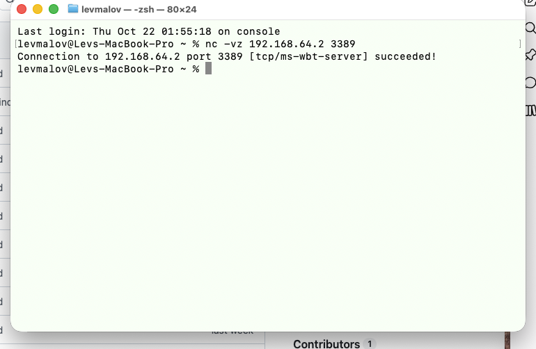
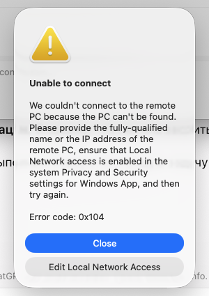
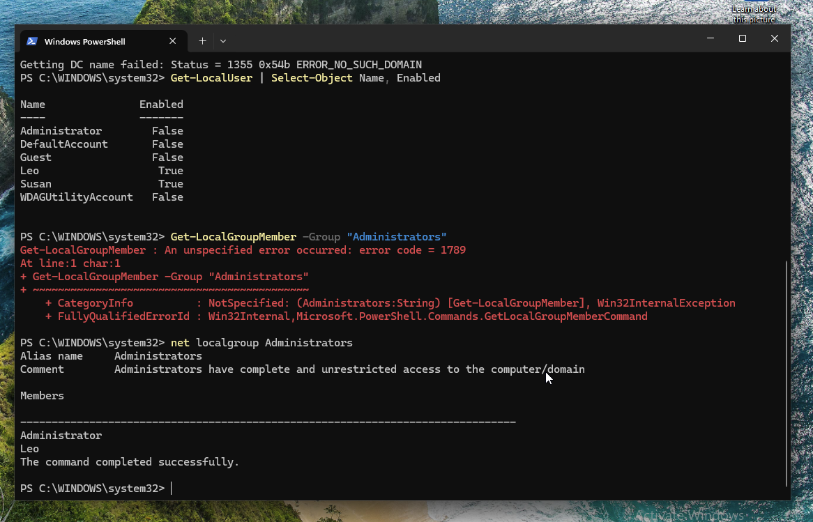
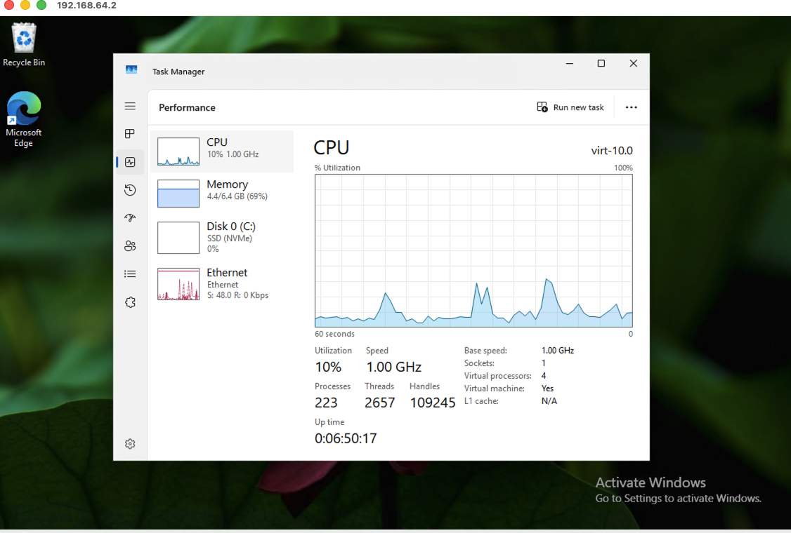
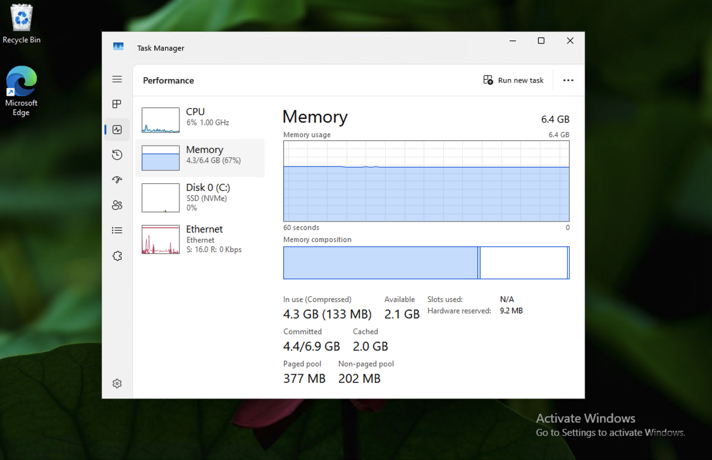
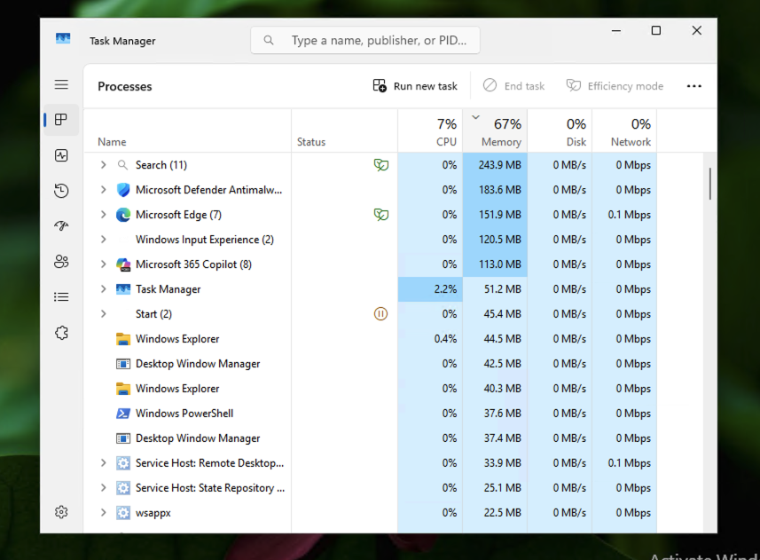

# Lab 14 — Remote Desktop Support (RDP)

## Objective
Configure and troubleshoot a Remote Desktop Protocol (RDP) connection from macOS to a Windows 10 Pro virtual machine, then perform a basic remote performance assessment and document the results in a Help Desk–style ticket.

## Lab Environment

- **RDP host:** Windows 10 Pro virtual machine running in UTM
- **RDP client:** Windows App on macOS
- **Network:** UTM virtual network, Windows VM at `192.168.64.2` during testing
- **Protocol:** RDP over TCP port `3389`
- **Authentication:** Local Windows account (`.\Leo`)
- **Diagnostic tools:** PowerShell, macOS Terminal, Windows Task Manager
- **Domain context:** VM was domain-joined to `corp.local`, but its domain controller was powered off during this exercise

> **Security:** This lab was performed on a controlled local virtual network. RDP was not exposed to the public internet. The IP address and account name are lab-specific examples.

## Procedure and Findings

### 1. Confirm RDP Host Requirements

Checked the Windows edition:

```powershell
Get-ComputerInfo | Select-Object WindowsProductName, WindowsEditionId
```

Result: **Windows 10 Pro**, which supports hosting incoming RDP sessions. Enabled **Settings → System → Remote Desktop** and obtained the VM's IPv4 address using `ipconfig`.

### 2. Verify RDP Port Connectivity from macOS

From macOS Terminal:

```bash
nc -vz 192.168.64.2 3389
```

Result: **TCP connection succeeded**, confirming that the RDP port was reachable from the Mac. This alone does not confirm successful RDP authentication.



### 3. Troubleshoot Windows App Connection Error

Added `192.168.64.2` as a saved PC in **Windows App** on macOS. The first attempt returned **error 0x104** and prompted a review of macOS **Local Network** permissions.

Enabled Local Network access for Windows App under **macOS System Settings → Privacy & Security → Local Network**. Retrying the connection then reached the credentials prompt.



### 4. Troubleshoot Domain Authentication

The domain credentials were not accepted. From the Windows VM:

```powershell
whoami
nltest /dsgetdc:corp.local
```

The active domain identity was `corp\testuser1`, but `nltest` returned **status 1355 (`ERROR_NO_SUCH_DOMAIN`)**. The domain controller was confirmed to be powered off. This prevented normal discovery of the domain controller and was a plausible cause of the domain sign-in failure.

To continue the RDP exercise without starting a second VM, switched to an existing local Windows account.

Checked local users and administrator membership:

```powershell
Get-LocalUser | Select-Object Name, Enabled
net localgroup Administrators
```

`Leo` was enabled and listed in the local **Administrators** group. An earlier attempt with `Get-LocalGroupMember -Group "Administrators"` produced error 1789, so the `net localgroup` command was used to verify membership instead.



### 5. Establish Remote Desktop Session

Connected from Windows App using the local account format:

```text
.\Leo
```

A certificate trust warning appeared for the lab VM. After verifying the intended local destination, continued the connection and successfully opened the Windows desktop remotely.



> **Production note:** Certificate warnings should not be accepted blindly on managed networks. Verify the remote host and use trusted certificates and approved remote-access methods.

### 6. Assess Memory and System Performance Remotely

Inside the RDP session, opened **Task Manager → Performance → Memory**.

Observed:

| Metric | Observation |
|---|---:|
| Installed/visible RAM | 6.4 GB |
| RAM in use | 4.3 GB (67%) |
| RAM available | 2.1 GB |
| Committed memory | 4.4 / 6.9 GB |
| CPU utilization | Approximately 6% at capture |
| Disk activity | 0% at capture |

The VM had moderate memory utilization, with approximately 2.1 GB available. The captured measurements did **not** demonstrate an acute CPU, memory, or disk bottleneck.



### 7. Identify Processes Using the Most Memory

Opened **Task Manager → Processes** and sorted by the **Memory** column (descending).

| Process | Memory at capture |
|---|---:|
| Search | 243.9 MB |
| Microsoft Defender Antimalware | 183.6 MB |
| Microsoft Edge | 151.9 MB |

No process was terminated. The snapshot did not establish that any one process was responsible for a slowdown.



## Example Help Desk Ticket

**Category:** Remote Support / Windows Performance  
**Issue:** User reports a slow Windows workstation; remote support session requested.  
**Impact:** Training scenario — no confirmed production outage.  
**Actions:**

1. Enabled and verified RDP access on Windows 10 Pro.
2. Confirmed TCP port 3389 reachability from macOS.
3. Resolved Windows App local-network permission issue (error 0x104).
4. Investigated unsuccessful domain authentication and verified domain controller discovery failure (status 1355).
5. Connected using an authorized local administrator account.
6. Reviewed CPU, memory, disk activity, and top memory-consuming processes via RDP.

**Outcome:** Remote session established successfully. System performance snapshot captured; no clear resource bottleneck observed at the time of testing. No application or service changes were necessary for the simulated performance complaint.

**Status:** Closed — remote access validated and baseline diagnostics completed.

## Skills Demonstrated

- Remote Desktop (RDP) configuration and connectivity testing
- macOS Windows App client setup and local-network permission troubleshooting
- Windows local vs. domain authentication troubleshooting
- Domain controller discovery diagnostics (`nltest`)
- Local account and administrator membership verification
- Remote Task Manager performance analysis
- Clear Help Desk ticket documentation

## Conclusion

Successfully established a macOS-to-Windows RDP connection, resolved a client-side permissions issue, worked around unavailable domain services using an authorized local account, and performed remote performance diagnostics. The lab documents both successful checks and encountered errors without claiming that a genuine workstation slowdown was reproduced or repaired.
