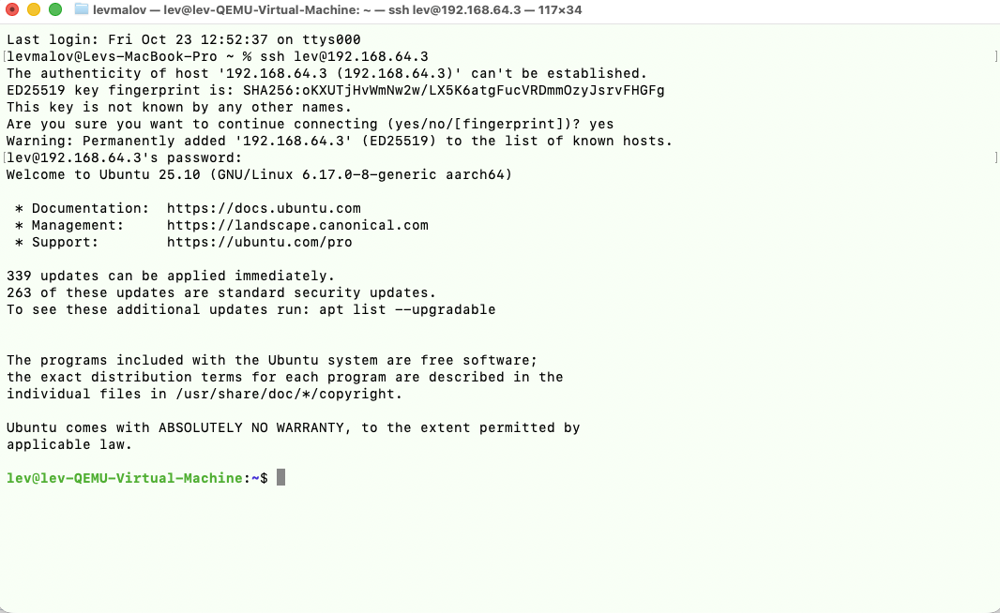
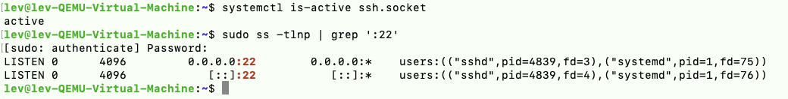
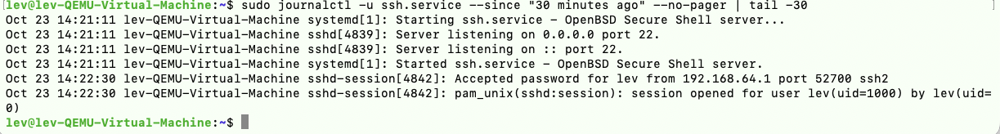

# Lab 15 — SSH Remote Support (Linux)

## Overview

This hands-on IT support lab demonstrates how to configure and validate remote access to an Ubuntu virtual machine from macOS using OpenSSH. After connecting, I collected system health information, checked the SSH listening socket and TCP port, and reviewed authentication logs to verify the session.

**Lab environment:** macOS on Apple Silicon (SSH client), UTM/QEMU virtual machine, Ubuntu 25.10 ARM64 (SSH host), UTM shared virtual network.

> This is a home lab simulating remote Linux support. It does not represent work performed in a production environment.

## Objectives

- Install OpenSSH Server on Ubuntu.
- Verify SSH socket activation and TCP port 22 availability.
- Establish an authenticated SSH session from macOS to Ubuntu.
- Collect system health metrics remotely.
- Confirm the successful SSH login in server logs.

## Environment

| Component | Configuration |
| --- | --- |
| Client | macOS Terminal, built-in `ssh` client |
| SSH server | Ubuntu 25.10, ARM64, running in UTM/QEMU |
| Ubuntu VM IP | `192.168.64.3` (lab-specific) |
| Mac client IP (observed in log) | `192.168.64.1` |
| Remote user | `lev` |
| SSH port | TCP 22 |
| Authentication | Password authentication (lab only) |

## Procedure and Evidence

### 1. Install and verify OpenSSH Server

On the Ubuntu VM, I identified the OS and checked whether the SSH service existed:

```bash
lsb_release -a
systemctl status ssh
```

Initially, `ssh.service` was not found. I installed OpenSSH Server:

```bash
sudo apt update
sudo apt install openssh-server -y
sudo systemctl status ssh
systemctl status ssh.socket
```

On this Ubuntu version, the socket was enabled and **active (listening)** even when `ssh.service` initially showed **inactive (dead)**. This is consistent with systemd socket activation: incoming connections can trigger the service.

### 2. Find the Ubuntu IP address and connect from macOS

On Ubuntu:

```bash
hostname -I
```

The VM reported `192.168.64.3`. From macOS Terminal, I connected with:

```bash
ssh lev@192.168.64.3
```

On the first connection, I reviewed the SSH host-key prompt, accepted the key for this lab host, and entered the Ubuntu account password. The terminal displayed the Ubuntu login banner and a remote shell prompt, confirming successful authentication.



### 3. Perform remote system diagnostics

While connected over SSH, I ran:

```bash
hostnamectl
uptime
free -h
df -h /
```

**Observed results:**

| Metric | Result |
| --- | --- |
| OS / architecture | Ubuntu 25.10 / arm64 |
| Virtualization | QEMU |
| Uptime | Approximately 21 minutes |
| Load average (1/5/15 min) | `0.00`, `0.03`, `0.05` |
| RAM | 3.3 GiB total, 1.2 GiB used, 2.1 GiB available |
| Swap | 3.8 GiB total, 0 used |
| Root filesystem | 62 GB total, 10 GB used, 49 GB available (17% used) |

**Assessment:** No immediate evidence of CPU load, memory exhaustion, or root filesystem capacity pressure at the time of testing. These are point-in-time observations, not a performance benchmark.


### 4. Verify SSH socket and listening port

From the remote session:

```bash
systemctl is-active ssh.socket
sudo ss -tlnp | grep ':22'
```

The socket returned `active`. The listening-port output showed `sshd` / `systemd` listening on `0.0.0.0:22` and `[::]:22`, confirming IPv4 and IPv6 TCP listeners.



### 5. Review SSH authentication logs

I checked the service journal:

```bash
sudo journalctl -u ssh.service --since "30 minutes ago" --no-pager | tail -30
```

The journal showed the SSH service starting and listening on port 22, followed by a successful login:

```text
Accepted password for lev from 192.168.64.1 port 52700 ssh2
pam_unix(sshd:session): session opened for user lev
```

This confirmed that the server logged the authenticated SSH session from the Mac client.



## Simulated IT Support Ticket

**Ticket title:** Verify remote SSH access and Linux host health

**Issue / request:** Confirm that a support technician can remotely access an Ubuntu VM and perform basic server diagnostics.

**Investigation:** Found that OpenSSH Server was not installed; installed the package, confirmed the SSH socket was listening on TCP 22, authenticated from macOS, checked host load, memory and disk, and reviewed the SSH authentication journal.

**Resolution:** Remote SSH access verified. Authentication succeeded, and the inspected health metrics showed no immediate resource bottleneck. No additional remediation was required for the simulated support request.

**Status:** Resolved (lab simulation).

## Key Takeaways

- The SSH **client** initiates the connection; the SSH **server** accepts it on TCP 22.
- On socket-activated systems, `ssh.service` may appear inactive before the first connection while `ssh.socket` remains active and listening.
- `hostnamectl`, `uptime`, `free -h`, and `df -h /` provide quick Linux health checks.
- `ss` helps verify listening ports, while `journalctl` provides service and authentication evidence.
- Password authentication was used for this isolated lab; production deployments should consider SSH key-based authentication, access controls, and hardened configuration.

## Screenshot Index

1. [Successful SSH connection](Screenshots/01-successful-ssh-connection.png)
2. [Remote system diagnostics](Screenshots/02-remote-system-diagnostics.png)
3. [SSH socket and TCP port verification](Screenshots/03-ssh-port-verification.png)
4. [SSH authentication logs](Screenshots/04-ssh-authentication-logs.png)
