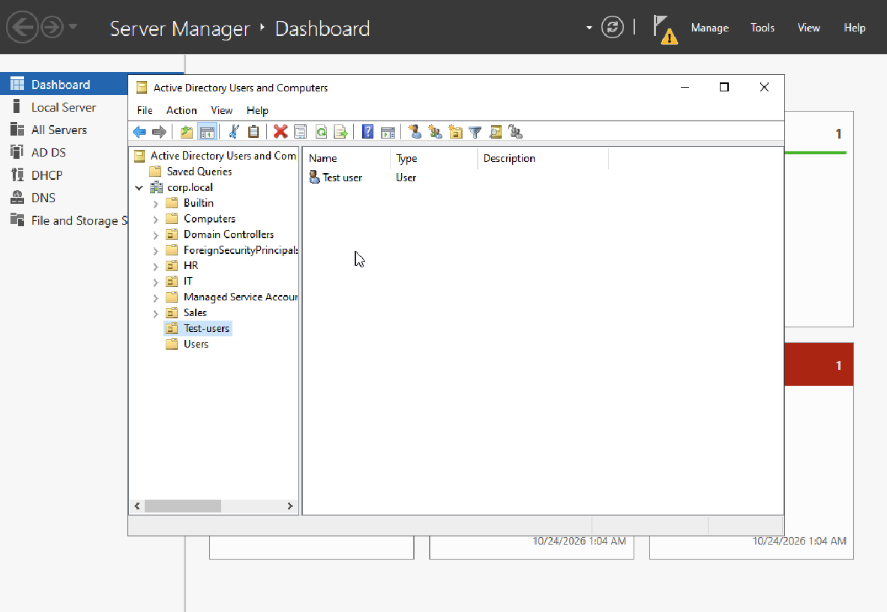
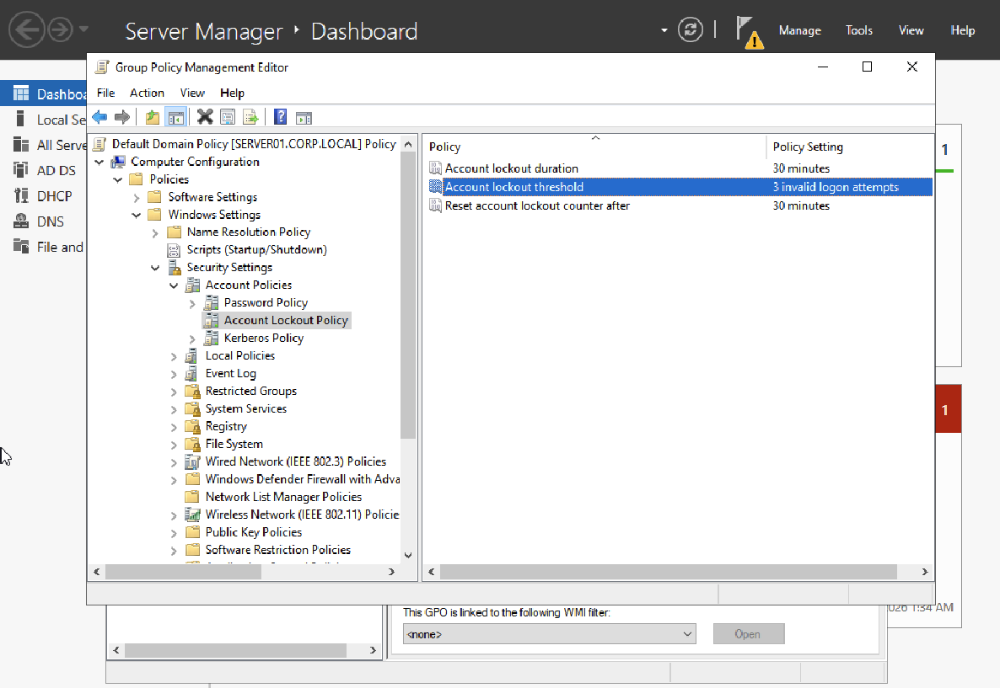
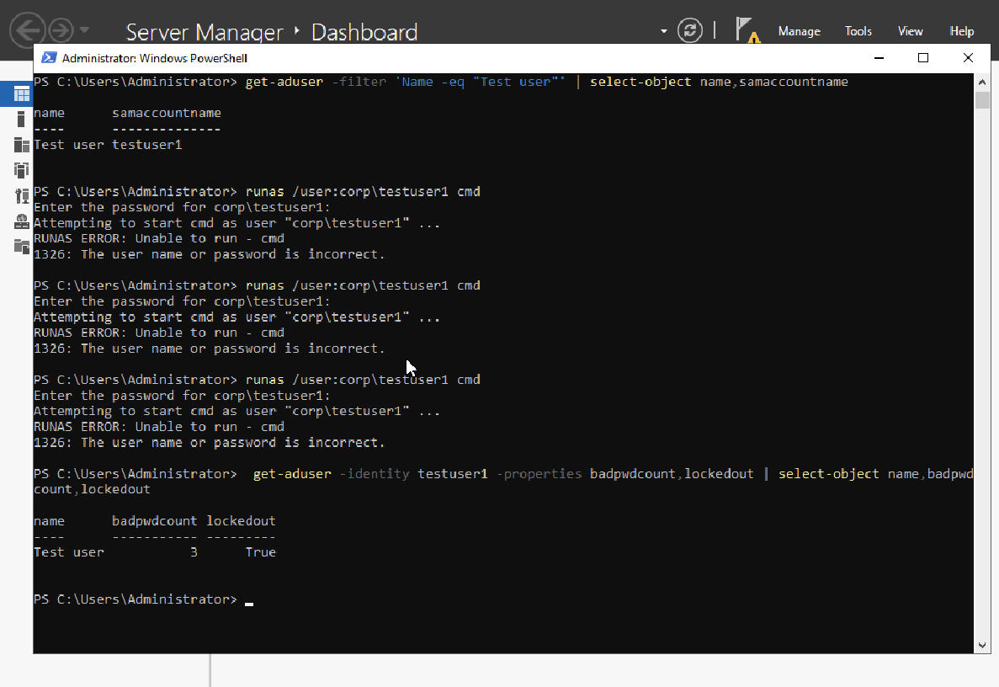
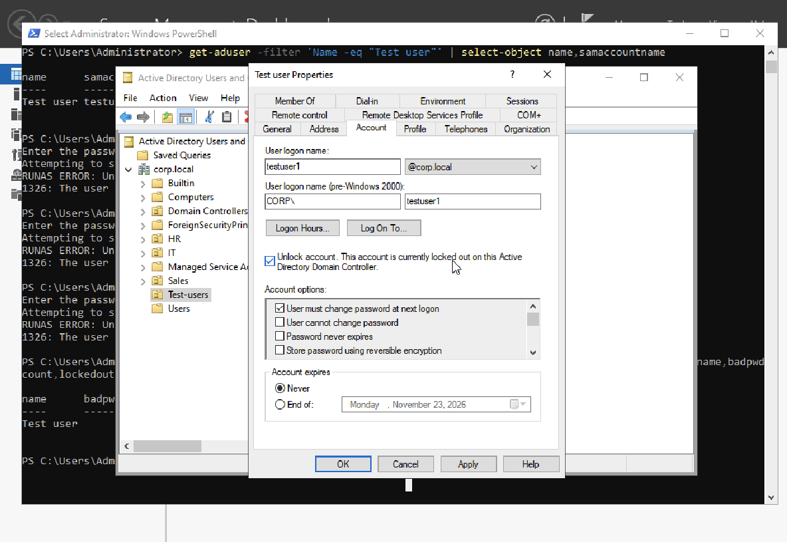
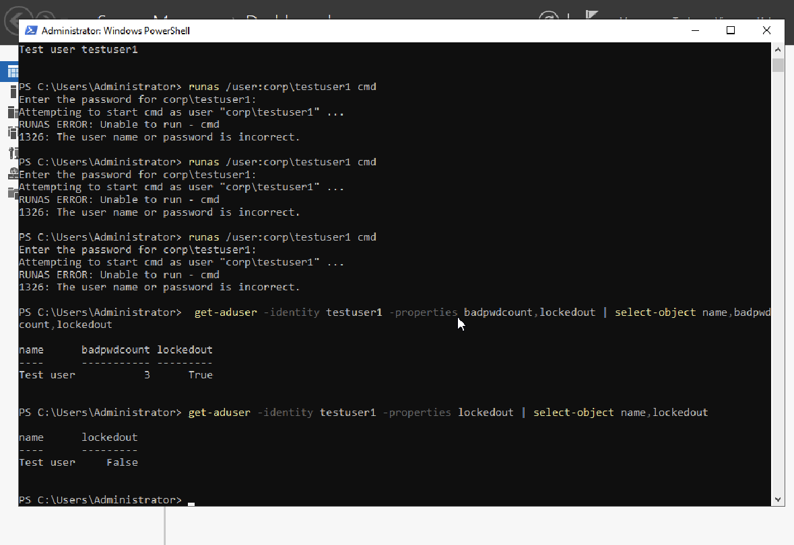
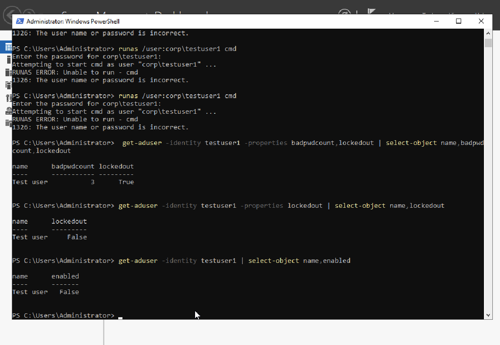
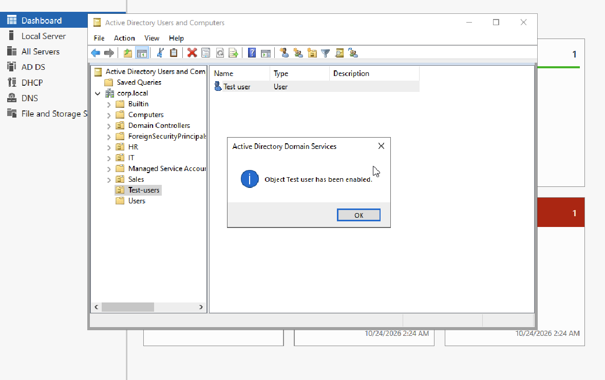
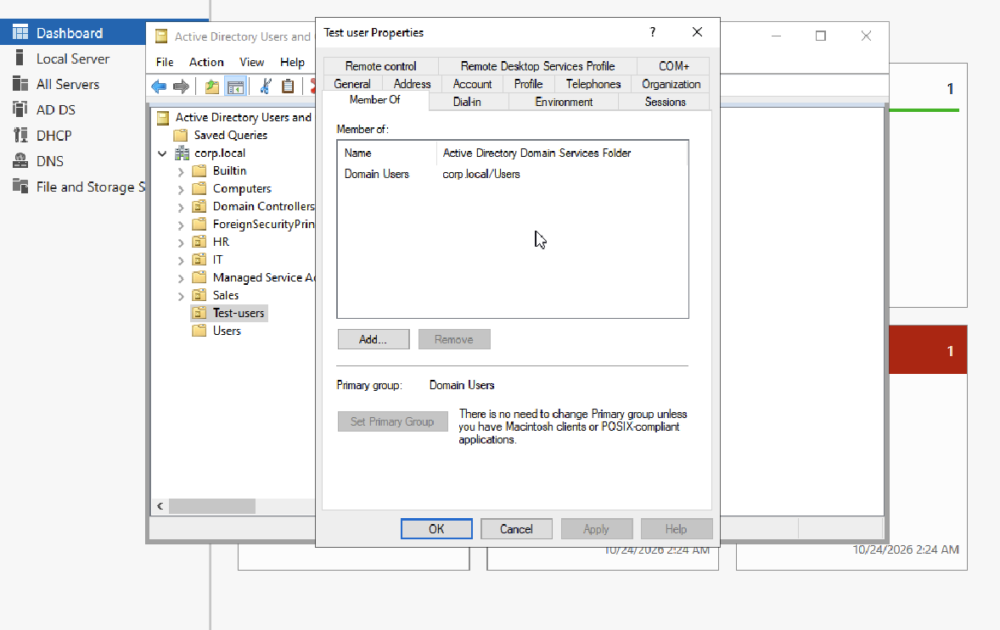
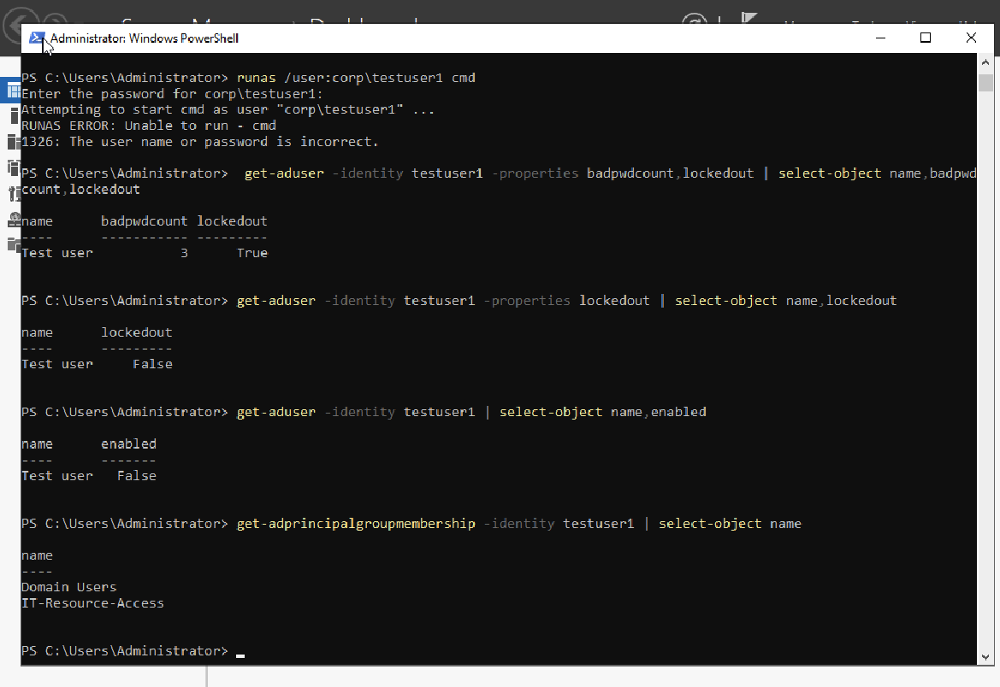
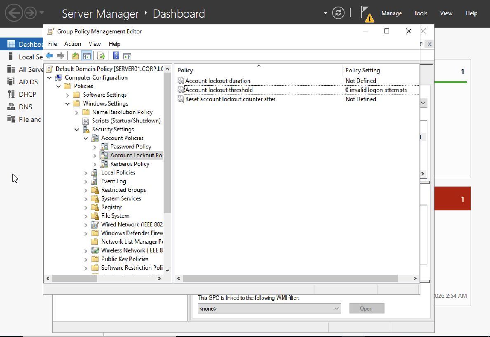

# Lab 16 — Active Directory User Account Troubleshooting

## Overview
Hands-on help desk scenarios using **Active Directory Domain Services (AD DS)** on a Windows Server 2022 domain controller. This lab covers password resets, account lockouts, disabled accounts, and security group membership. All work was performed in a **test domain**, not a production environment.

## Environment
- **Hypervisor:** UTM on Apple Silicon Mac
- **Server:** Windows Server 2022 (domain controller)
- **Domain:** `corp.local`
- **Test account:** `Test user` (`CORP\testuser1`) in the `Test-users` OU
- **Tools:** Active Directory Users and Computers (ADUC), Group Policy Management, Windows PowerShell (ActiveDirectory module)

## Objectives
1. Reset a forgotten password and require a change at next sign-in.
2. Reproduce a domain account lockout, identify it, and unlock the account.
3. Disable and re-enable a user account, confirming the account state.
4. Grant access by adding a user to an appropriate security group and verifying membership.
5. Restore the original domain lockout policy after testing.

## Scenario 1 — Password Reset
**Ticket:** User forgot their domain password.

1. Located `Test user` under `corp.local → Test-users` in ADUC.
2. Right-clicked the account and selected **Reset Password**.
3. Assigned a temporary password and selected **User must change password at next logon**.
4. Confirmed the reset completed successfully.

**Result:** Administrative password reset completed. A separate user sign-in was not performed, so the forced password change was not independently tested.



## Scenario 2 — Account Lockout
**Ticket:** User reports being locked out after repeated failed sign-ins.

1. Inspected `Default Domain Policy → Computer Configuration → Policies → Windows Settings → Security Settings → Account Policies → Account Lockout Policy`.
2. Original lockout threshold was **0** (lockout disabled). Temporarily set the threshold to **3** invalid attempts, with a **30-minute** duration and counter reset.
3. Applied policy using `gpupdate /force`.
4. Identified the test account's actual `sAMAccountName` as `testuser1` rather than `testuser`.
5. Issued three intentionally incorrect authentication attempts for `CORP\testuser1` using `runas`.
6. Verified `badPwdCount = 3` and `LockedOut = True`.
7. Used ADUC → **Account** → **Unlock account**, then verified `LockedOut = False`.

```powershell
Get-ADUser -Filter 'Name -eq "Test user"' | Select-Object Name,SamAccountName
runas /user:corp\testuser1 cmd
Get-ADUser -Identity testuser1 -Properties badPwdCount,LockedOut | Select-Object Name,badPwdCount,LockedOut
```

**Result:** Lockout reproduced and resolved successfully.






## Scenario 3 — Disabled Account
**Ticket:** User cannot access the domain because the account is disabled.

1. Disabled `Test user` in ADUC.
2. Verified `Enabled = False` in PowerShell.
3. Re-enabled the account through ADUC.
4. Confirmed the ADUC success notification. A separate post-enable PowerShell check was not captured.

```powershell
Get-ADUser -Identity testuser1 | Select-Object Name,Enabled
```

**Result:** Disabled state verified and account re-enabled.




## Scenario 4 — Security Group Membership
**Ticket:** User needs approved access to an IT resource.

1. Inspected the account's **Member Of** tab; initially only `Domain Users` was listed.
2. Created a **Global Security** group named `IT-Resource-Access` in the `IT` OU.
3. Added `Test user` to the new group using ADUC.
4. Verified membership using PowerShell.

```powershell
Get-ADPrincipalGroupMembership -Identity testuser1 | Select-Object Name
```

**Result:** Membership confirmed in `Domain Users` and `IT-Resource-Access`. This demonstrates group-based access administration; an actual file share or resource permission was not configured or tested.




## Cleanup and Safety
- Restored **Account lockout threshold = 0 invalid logon attempts**.
- Verified **Account lockout duration = Not Defined** and **Reset account lockout counter after = Not Defined**, matching the original settings.
- Ran `gpupdate /force` after restoring the policy.
- Kept changes limited to the lab test account and a nonprivileged test security group.
- No passwords are included in the repository.



> **Production note:** Changing the Default Domain Policy affects domain-wide authentication behavior. In a real organization, policy changes require authorization and change control; lockout troubleshooting should follow identity verification and security procedures. A production domain should not disable lockouts simply to match this test lab's original setting.

## Skills Demonstrated
`Active Directory` · `AD DS` · `Windows Server 2022` · `ADUC` · `Password Reset` · `Account Lockout` · `Group Policy` · `PowerShell` · `Account Enable/Disable` · `Security Groups` · `Access Management` · `Help Desk Troubleshooting`
