# Lab 17 – VPN Connection Troubleshooting

## Objective
Investigate and troubleshoot a Windows Server 2022 VPN (Routing and Remote Access) configuration in an isolated virtual lab. Restore the RRAS service, inspect VPN ports and authentication, and identify outstanding requirements for an IKEv2 connection.

> **Scope:** This is a troubleshooting and configuration investigation, **not** a verified end-to-end VPN deployment. No successful VPN client session was established.

## Environment
- **Hypervisor:** UTM on macOS
- **Server:** Windows Server 2022 (`SERVER01`), Active Directory domain `corp.local`
- **Client:** Windows 10 (`CLIENT01`)
- **Services:** Active Directory Domain Services, DNS, DHCP, Remote Access (RRAS)
- **Lab network:** `10.10.10.0/24` (server and client addressing verified during troubleshooting)

## Investigation and actions

### 1. Inspect IP addressing and connectivity
Reviewed server/client IP configuration, DHCP settings, and basic network reachability. Verified that the Windows client could communicate with the server using ping. Address-pool configuration in RRAS was investigated but did not persist reliably in the console; a working VPN address-assignment path was **not** confirmed.

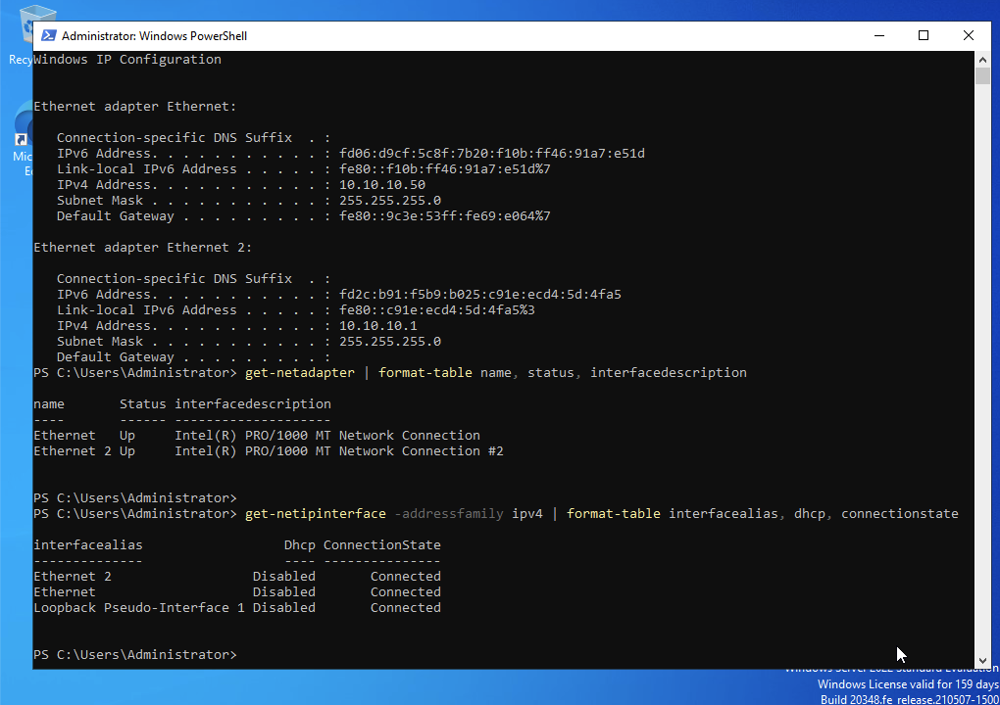


### 2. Install and configure Remote Access
Installed the **Remote Access** role with **DirectAccess and VPN (RAS)** and used the Routing and Remote Access configuration wizard to select **VPN access**.

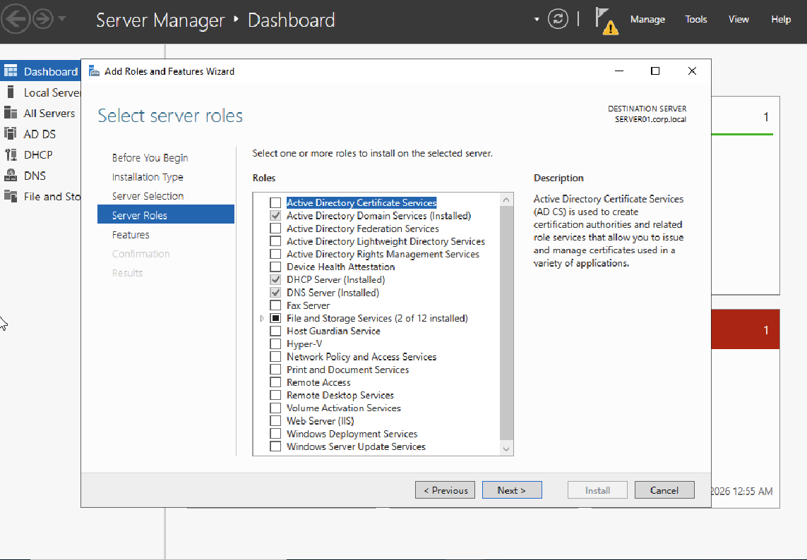
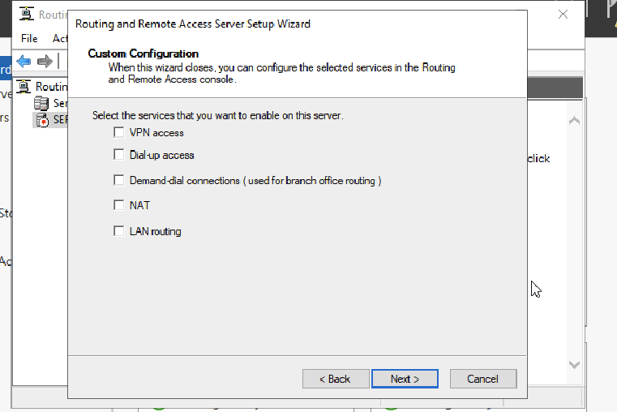
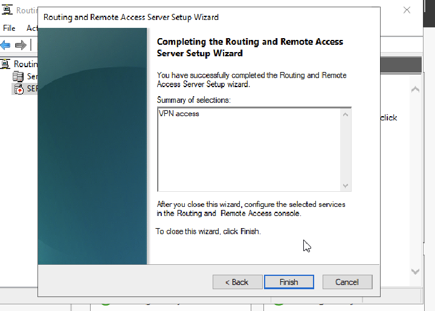

### 3. Restore the RRAS service
Found that the `RemoteAccess` service was stopped and disabled. Changed startup type to **Manual** and started the service:

```powershell
Set-Service -Name RemoteAccess -StartupType Manual
Start-Service -Name RemoteAccess
Get-Service RemoteAccess | Select-Object Name, Status, StartType
```

The final check showed `RemoteAccess` **Running** with startup type **Manual**.

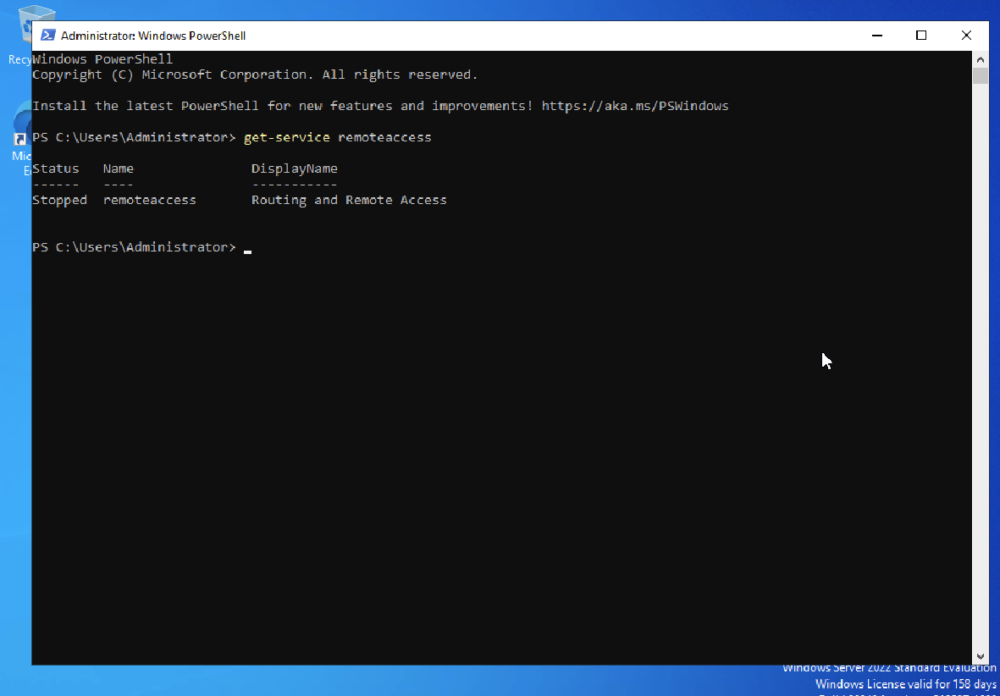

### 4. Inspect and configure VPN ports
Reviewed RRAS **Ports** and enabled **WAN Miniport (IKEv2)** for inbound remote access connections. Confirmed that the port was assigned to **RAS**. This establishes port configuration only; it does not prove an IKEv2 tunnel can be established.

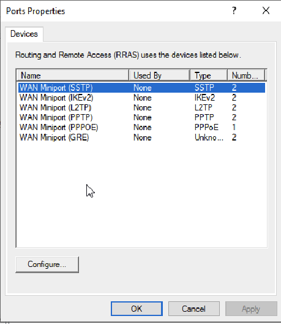
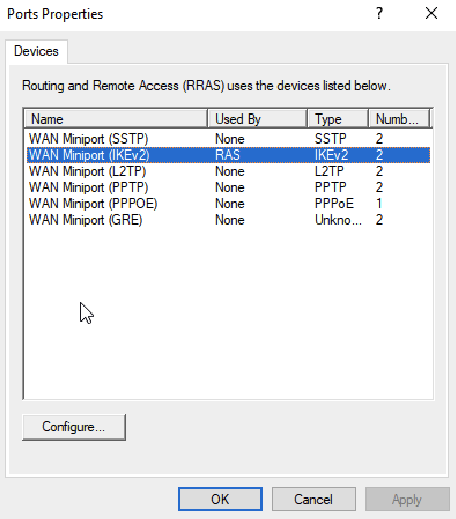

### 5. Repair and review authentication settings
The RRAS console reported a corrupted authentication/accounting connection-request policy. Used **Repair Settings**, which displayed a successful repair confirmation. Reviewed authentication methods: **EAP** and **MS-CHAP v2** enabled; **PAP** and **CHAP** disabled.

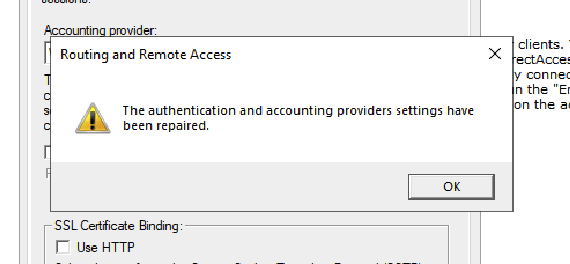
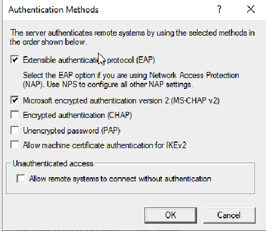

### 6. Investigate IKEv2 certificate requirements
Opened the Local Computer certificate store (`certlm.msc`) and found **no certificates** under **Personal → Certificates**. Checked the Certificate Authority role:

```powershell
Get-WindowsFeature ADCS-Cert-Authority
```

The result was **Available**, meaning the role was not installed. A suitable trusted server certificate is required to complete this IKEv2 VPN deployment. Certificate Authority installation, certificate enrollment, and client configuration were intentionally deferred.

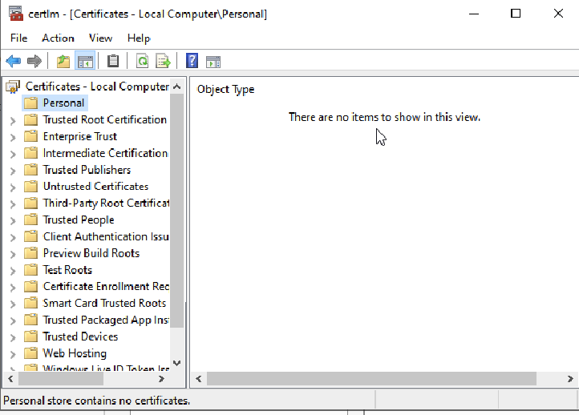
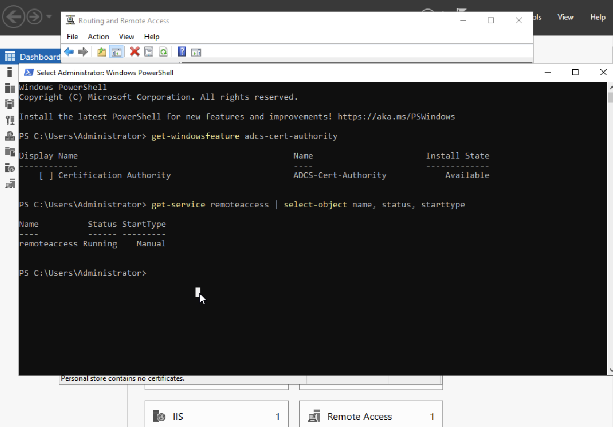

## Results
| Check | Outcome |
| --- | --- |
| Server/client basic network reachability | Verified |
| Remote Access role / RRAS configuration | Installed and configured for VPN access |
| `RemoteAccess` service | **Running**, startup type **Manual** |
| IKEv2 inbound port | Configured for RAS |
| Authentication/accounting configuration warning | Repair completed in RRAS UI |
| Suitable IKEv2 server certificate | **Not present** in Local Computer Personal store |
| End-to-end VPN connection | **Not established or tested** |
| VPN client address assignment | **Not validated** |

## Skills practiced
Windows Server administration · RRAS service troubleshooting · DHCP and IPv4 diagnostics · VPN port configuration · Authentication policy troubleshooting · Certificate investigation · PowerShell · Technical documentation

## Conclusion
Restored the RRAS service, reviewed the VPN configuration, and repaired an authentication/accounting settings warning. Identified the absence of a suitable server certificate as a remaining prerequisite for IKEv2 deployment. Full certificate provisioning and end-to-end VPN testing are appropriate for a future advanced lab.
