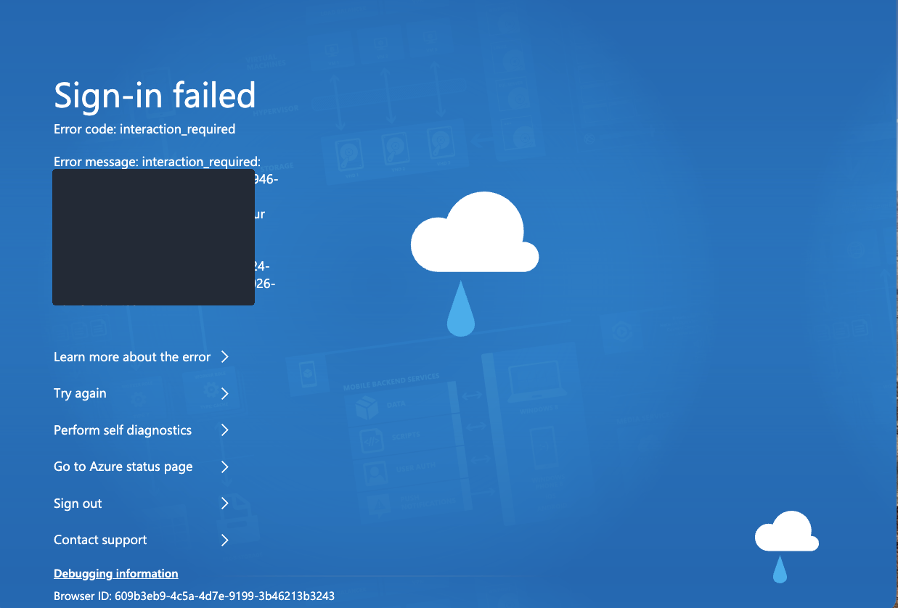
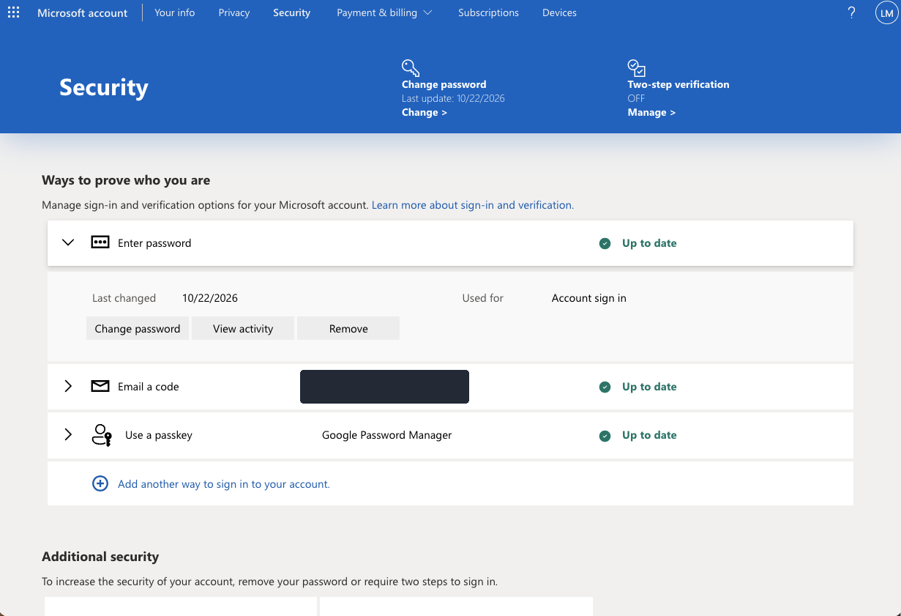
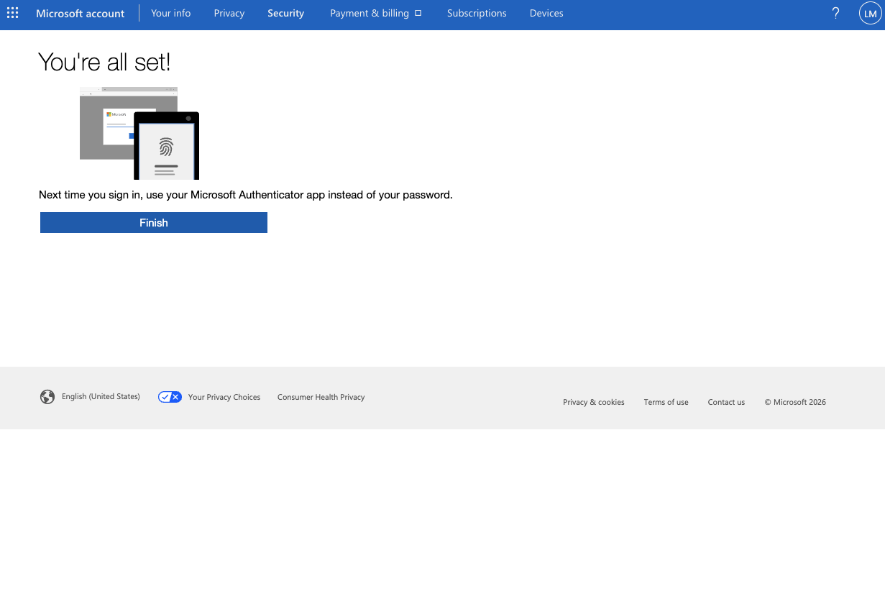
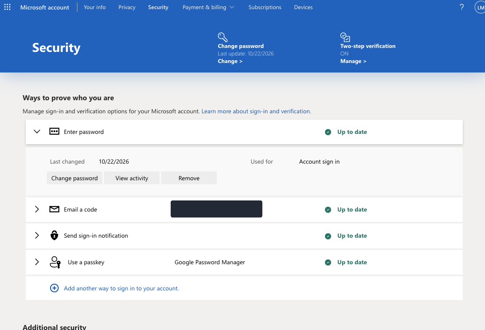
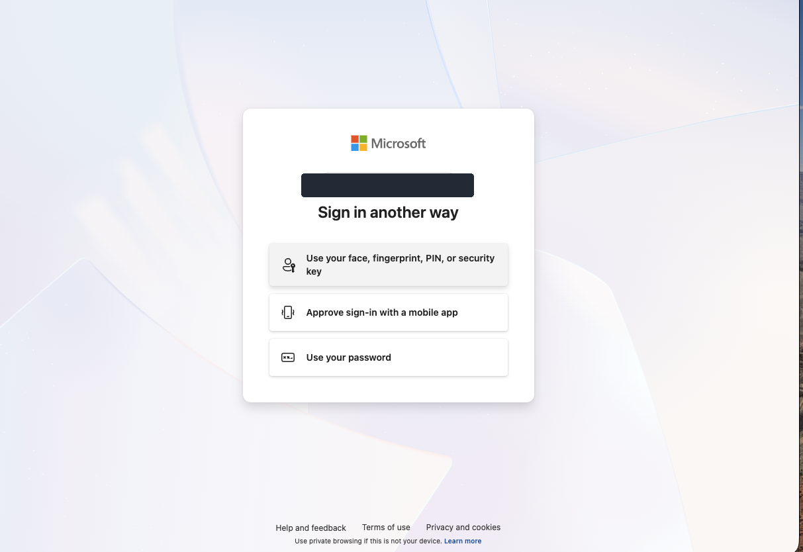
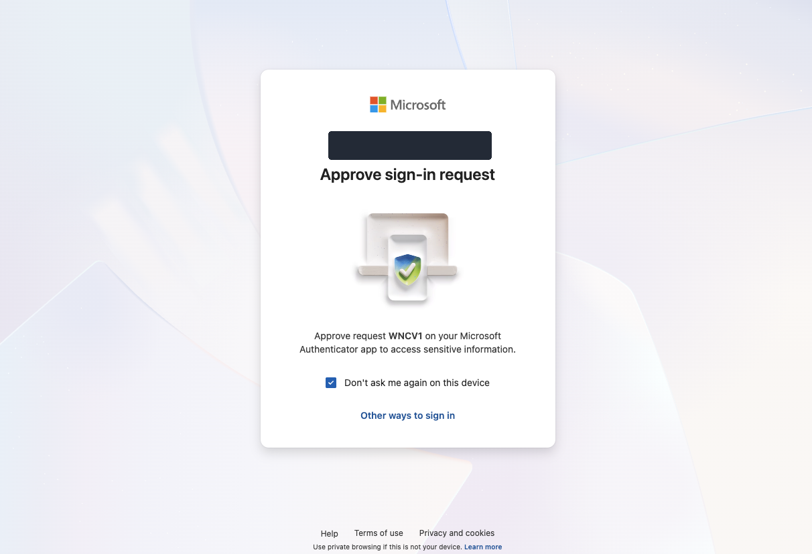
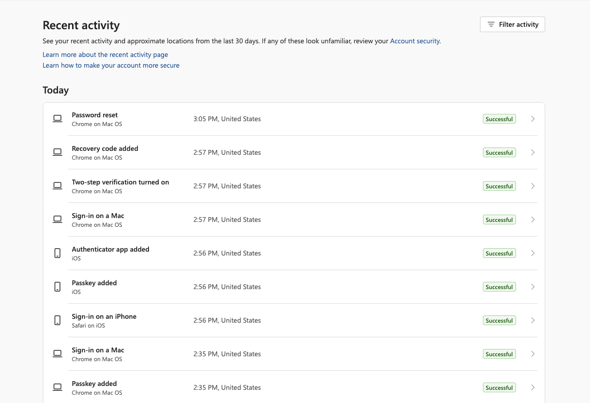
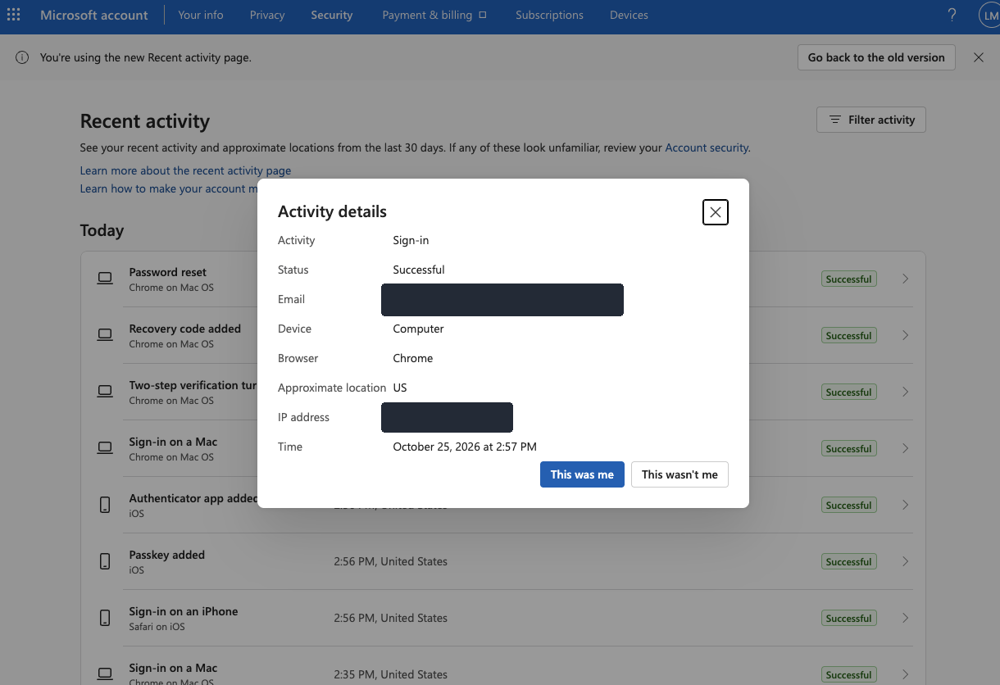
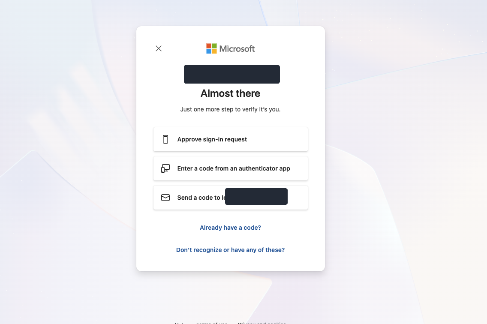

# Lab 18 – MFA & SSO Troubleshooting

## Objective
Configure and test multi-factor authentication (MFA), examine sign-in activity, investigate notification behavior, validate a backup verification method, and observe shared sign-in sessions across Microsoft services.

> **Scope:** This lab used a **personal Microsoft account**, not a Microsoft Entra ID organizational tenant. The SSO portion demonstrates browser session reuse across consumer Microsoft services; it does **not** validate enterprise SSO, Conditional Access, or Entra sign-in logs.

## Environment
- macOS / Google Chrome (normal and Incognito sessions)
- iPhone / Microsoft Authenticator
- Microsoft Account security settings, Recent activity, and Outlook on the web
- No Windows virtual machines or paid Microsoft 365 license required

## Investigation and Exercises

### 1. Investigate organizational tenant access
Attempted to access Microsoft Entra admin center. Received `AADSTS5000228` (tenant access denied); Microsoft 365 admin center also returned an authorization error. The tenant's actual status and the cause of the restriction were **not established**. Continued using an accessible personal Microsoft account without purchasing a subscription.

### 2. Review and configure MFA
Reviewed available authentication methods (password, backup email, passkey). Two-step verification was initially disabled. Registered Microsoft Authenticator and completed the two-step verification setup. Verified the security page displayed **Two-step verification: ON**.

### 3. Test password sign-in with additional verification
Opened a new Incognito session. The browser offered a saved passkey; canceled the passkey prompt and selected password sign-in instead. After password entry, Microsoft requested approval in Microsoft Authenticator. Approved the request on the phone and signed in successfully.

### 4. Review security activity
Opened the Microsoft account **Recent activity** page. Observed successful events for Authenticator enrollment, two-step verification activation, and sign-in. Reviewed a sign-in detail entry including status, device type, browser, and time. A password reset event was verified with the account owner as intentional. The consumer activity page did not establish the exact authentication method for each event.

### 5. Troubleshoot missing push notification
Checked iPhone notification settings, Focus mode, background refresh, and cellular connectivity. The sign-in request was visible inside Microsoft Authenticator even when no push banner appeared. The account owner intentionally limits push notifications. **No root cause or application malfunction was confirmed**, and authentication remained functional.

### 6. Verify backup MFA method
After entering the password, selected **Other ways to sign in**. Microsoft offered app approval, an authenticator code, and an email verification code. Used the registered backup email to receive a code and successfully complete sign-in. No recovery codes or verification secrets were saved to the repository.

### 7. Observe session reuse across Microsoft services
While signed into Microsoft Account, opened Outlook on the web in another tab of the same browser session; Outlook opened without requesting credentials again. In a separate Incognito session without the existing sign-in state, Outlook requested authentication. This demonstrates shared session behavior, **not enterprise federation or Entra SSO configuration**.

## Results
| Test | Outcome |
| --- | --- |
| Microsoft Authenticator registration | Successful |
| Two-step verification enabled | Confirmed ON |
| Password + additional Authenticator approval | Successful |
| Backup email verification | Successful |
| Security activity review | Completed |
| Notification delivery investigation | Request visible in app; push banner not observed |
| Existing browser session reused by Outlook | Observed |
| New Incognito session required sign-in | Observed |
| Enterprise Entra ID SSO / Conditional Access | Not tested |

## Skills Practiced
- MFA enrollment and verification
- Distinguishing passkeys from password-plus-MFA
- Alternative verification and account recovery awareness
- Authentication activity review
- Troubleshooting notification and connectivity settings
- Browser session isolation and sign-in behavior
- Security-conscious documentation and redaction

## Security Notes
- Screenshots are selectively redacted to conceal account addresses, IP information, and tenant identifiers where visible.
- Never upload QR enrollment secrets, one-time codes, recovery codes, or passwords.
- Account-specific personal identifiers have been omitted from this README.

## Conclusion
Successfully configured and tested two-step verification on a personal Microsoft account, validated Authenticator and backup email verification, reviewed security activity, and demonstrated session reuse between Microsoft services. Enterprise SSO administration remains a separate future exercise requiring an accessible organizational tenant.
