# Lab 19 – Microsoft Entra ID Administration

## Objective
Practice identity and access management tasks in a Microsoft Entra ID Free tenant, including user lifecycle management, security groups, authentication troubleshooting, and audit-log review.

## Environment
- Microsoft Entra admin center and Azure portal
- Microsoft Entra ID Free directory
- Cloud-only test user: **John Smith**
- Security group: **IT-Support**
- Web browser with separate sign-in sessions

## Tasks performed
1. Reviewed the Microsoft Entra directory and existing users.
2. Created a cloud-only test user with organizational profile information.
3. Verified the new account in the directory.
4. Created an assigned-membership **Security** group named `IT-Support`.
5. Added John Smith to the group and verified direct membership.
6. Reviewed and edited user account properties.
7. Tested account disable/re-enable and administrative password reset.
8. Verified the test user's forced password change at sign-in.
9. Signed in with the test account and reviewed its user profile.
10. Examined interactive sign-in logs for successful and interrupted sign-ins.
11. Reviewed user-management audit events, including password and account-state changes.
12. Examined group-management audit events for group creation and member addition.
13. Opened an `Add member to group` event and verified **Status: success**, with the user and group identified as targets.

## Evidence

### 01. 01 Entra Directory Overview
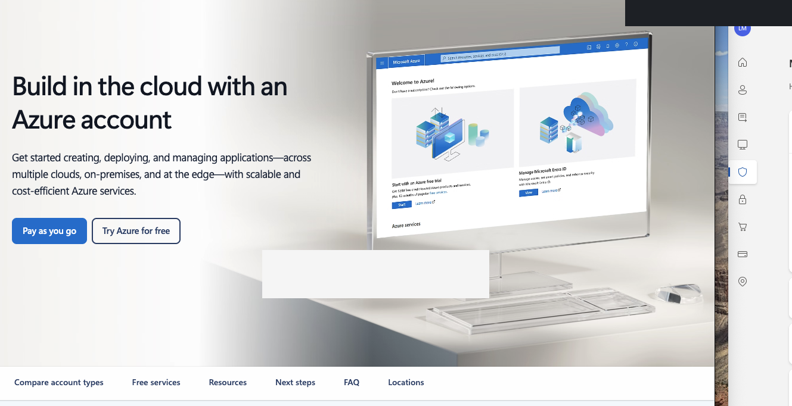

### 02. 02 Create User
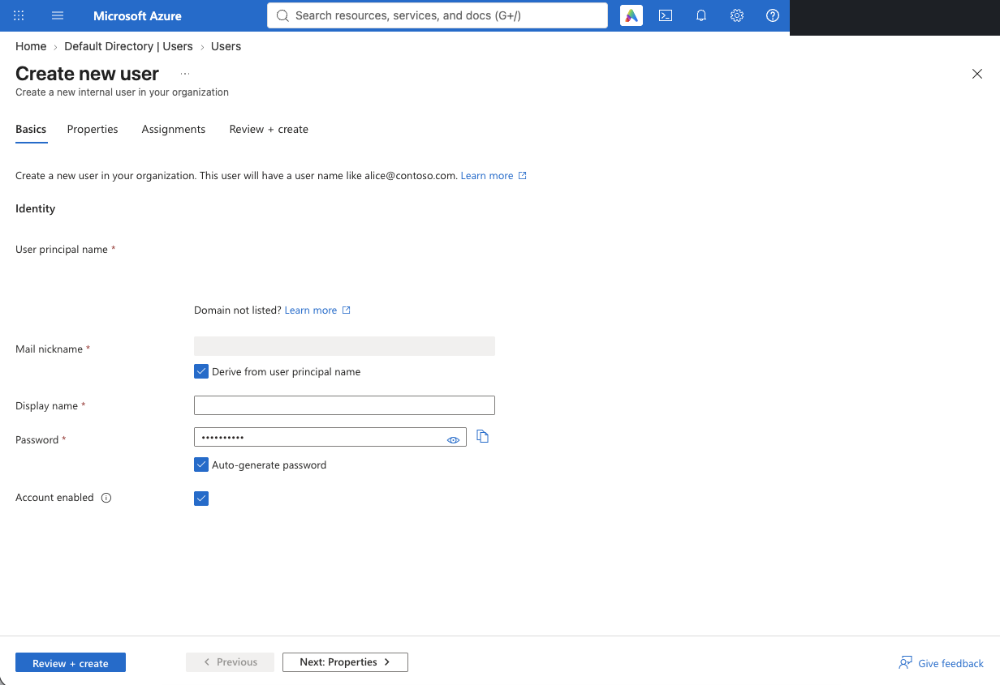

### 03. 03 User Created
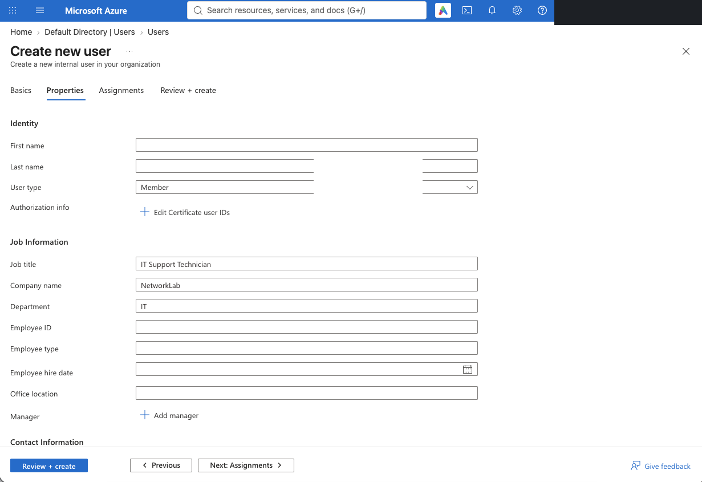

### 04. 04 Security Group Setup
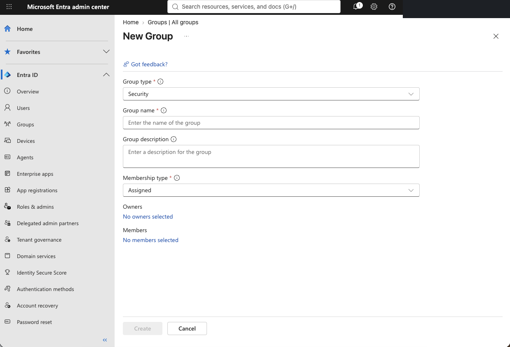

### 05. 05 Security Group Created
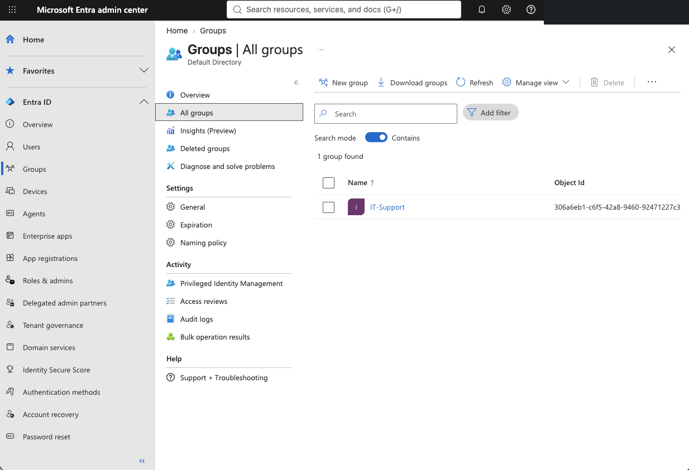

### 06. 06 Group Membership
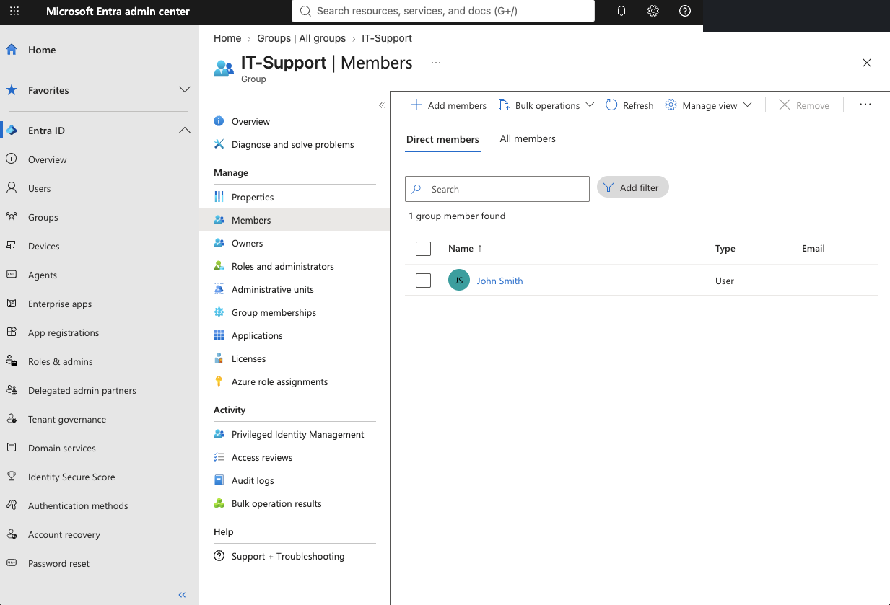

### 07. 07 Account Management
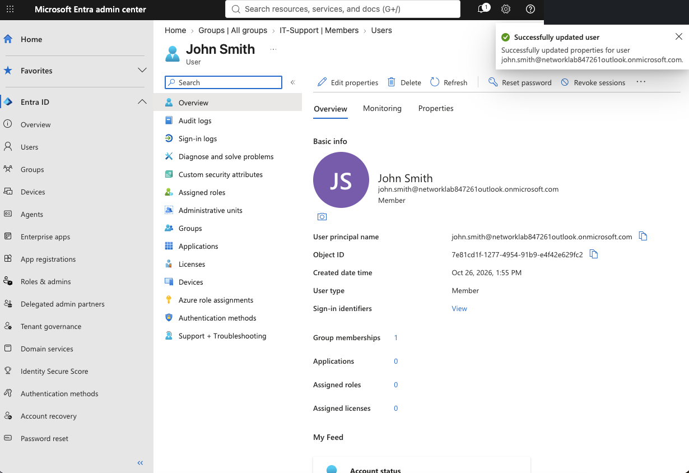

### 08. 08 User Sign In
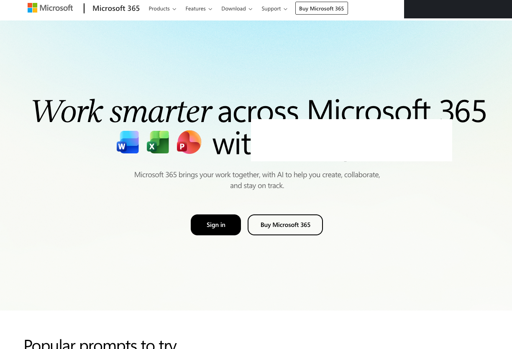

### 09. 09 Sign In Logs
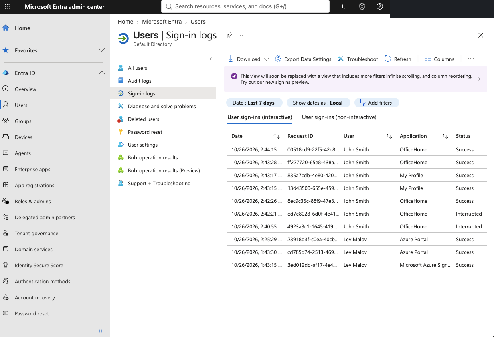

### 10. 10 User Audit Logs
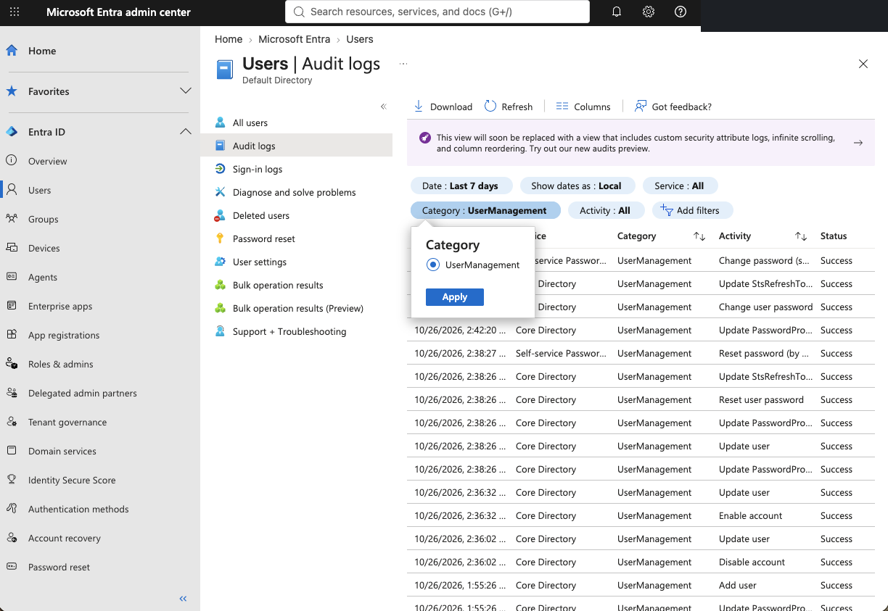

### 11. 11 Group Audit Logs
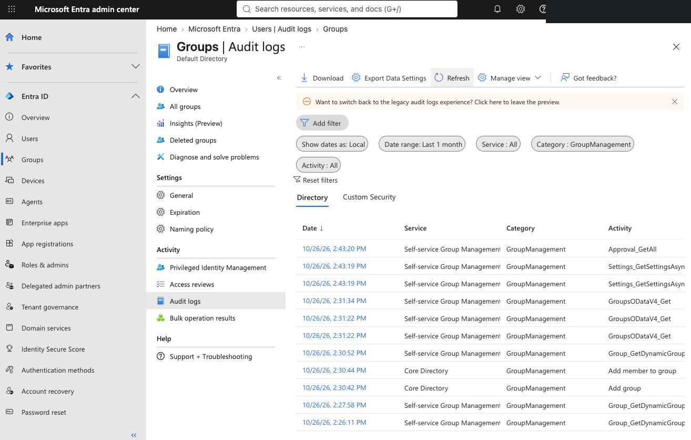

### 12. 12 Audit Event Status
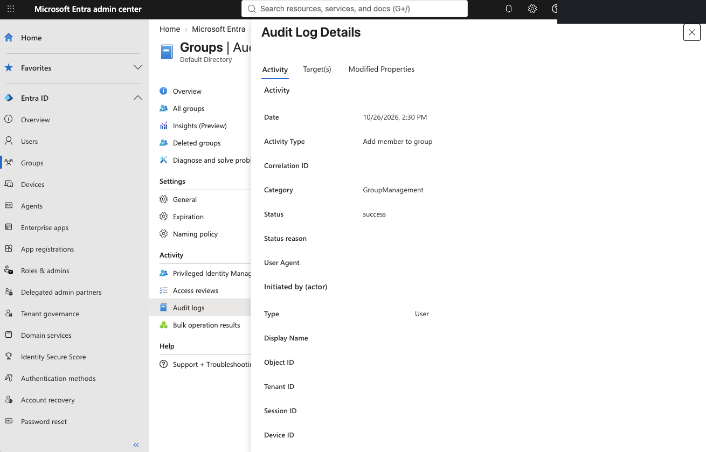

### 13. 13 Audit Event Targets
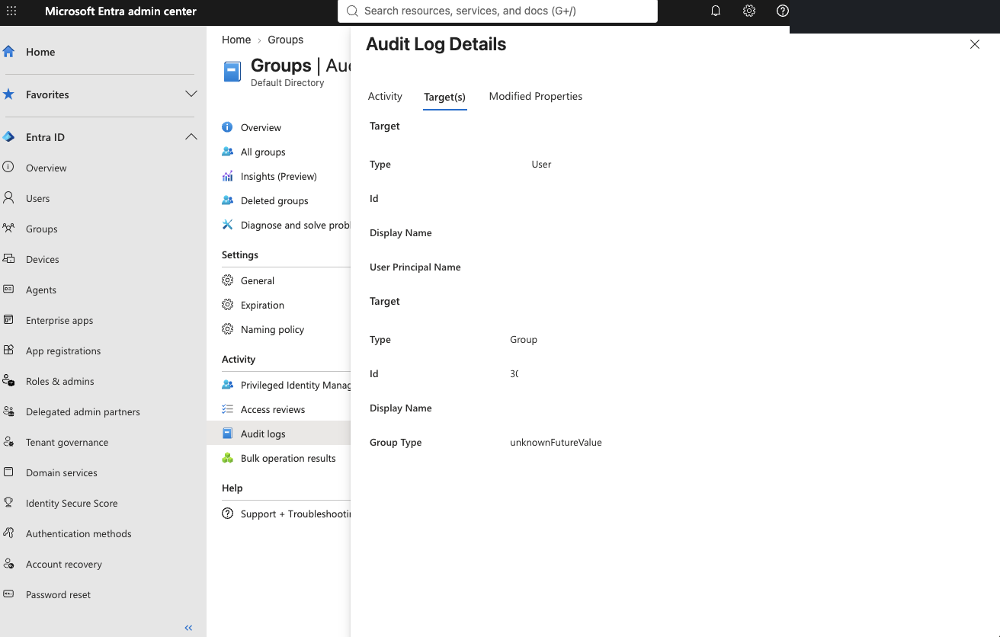

## Results
Successfully performed basic Microsoft Entra ID administration and validated operations through sign-in and audit logs. Confirmed that adding the test user to a security group produced a successful `GroupManagement` audit event.

## Scope and limitations
This lab used **Microsoft Entra ID Free**. It did not configure paid features such as Conditional Access policies or Privileged Identity Management, and it did not deploy production identities or services.

## Security and privacy
Screenshots have been edited to obscure account identifiers and selected directory IDs. Test user names and lab group names are fictional. No passwords, temporary passwords, recovery codes, or payment information are included. Review screenshots before making the repository public.
