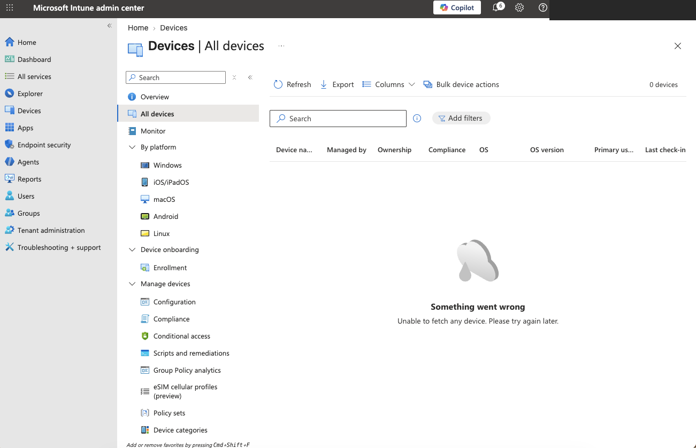
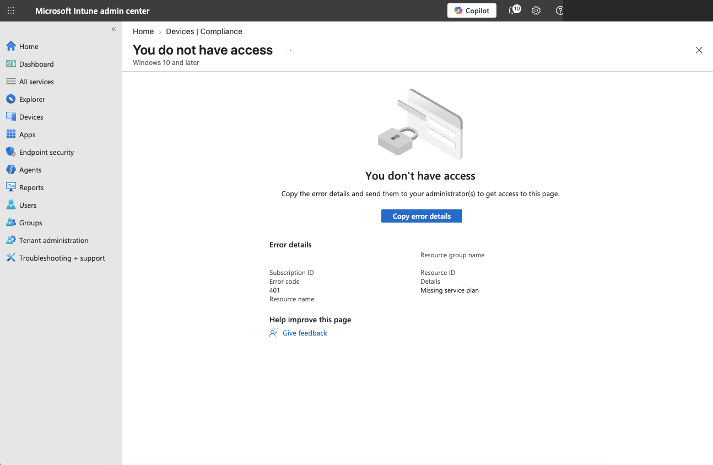
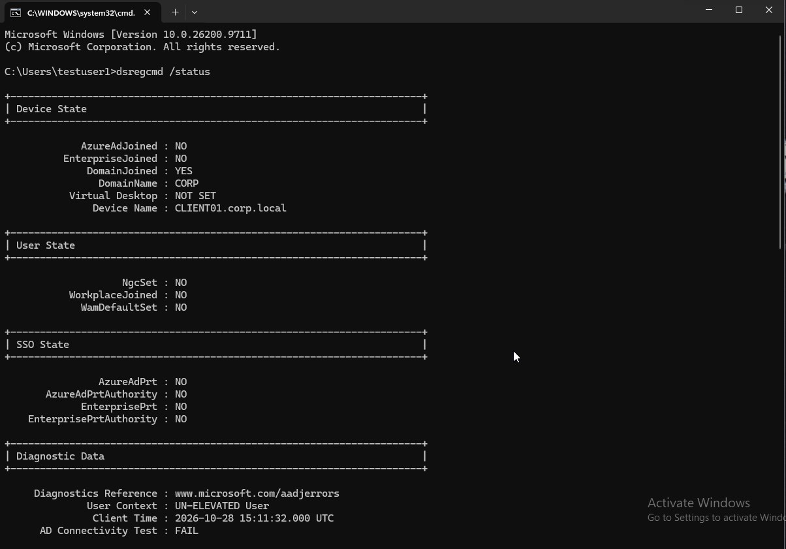
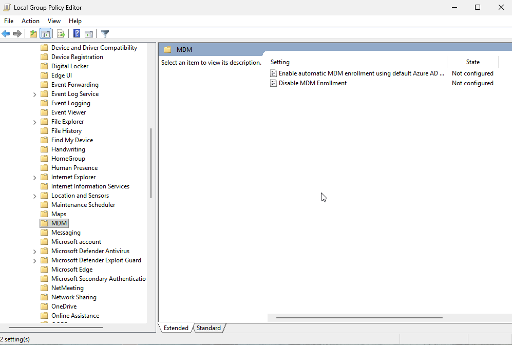
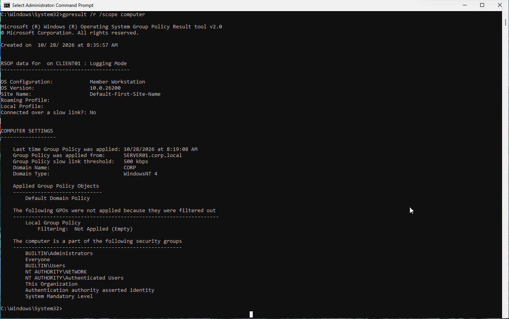
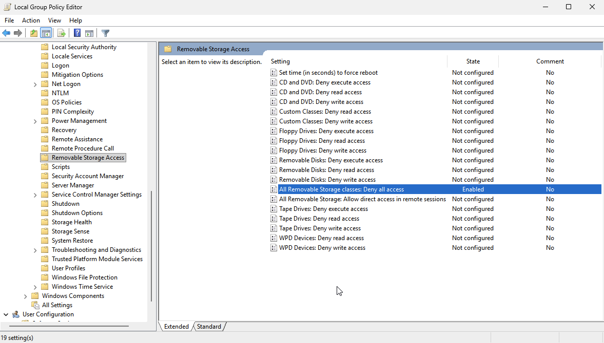
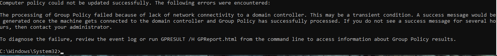
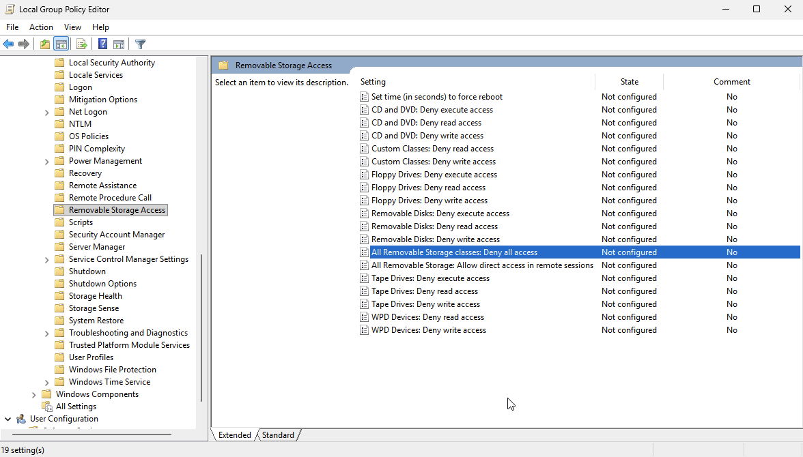

# Lab 21 — Windows Endpoint Management & MDM Troubleshooting

## Overview
Investigated Microsoft Intune access limitations, inspected Windows MDM enrollment settings, diagnosed Active Directory/Group Policy connectivity, and tested a local removable-storage restriction in a virtual lab. **This is not a completed Intune device enrollment or Intune policy deployment.**

## Lab environment
- Windows client VM: `CLIENT01.corp.local` (Windows build 10.0.26200; Windows 11 family)
- On-premises AD domain: `corp.local`
- Domain controller/DNS: `SERVER01.corp.local` (powered off during troubleshooting)
- Microsoft Intune and Entra admin portals (limited account entitlements)
- Local Group Policy Editor and elevated Command Prompt

## Objectives
1. Assess access to Intune device and compliance management.
2. Identify domain join vs. Microsoft Entra join and workplace registration.
3. Inspect MDM enrollment policies without enrolling a device.
4. Diagnose Group Policy and domain-controller connectivity.
5. Change, inspect, and restore a local endpoint security policy.

## Procedure and observations

### 1. Intune portal assessment
- Opened Intune admin center; device inventory and compliance policy lists failed to load.
- Attempting to create a Windows 10/11 compliance policy resulted in **401 — Missing service plan**.
- An Entra license-usage page returned a **401** with a message requiring Microsoft Entra ID Premium for that page.
- No license was purchased and no trial was started. These errors indicate unavailable entitlements for the tested operations, not a comprehensive inventory of assigned licenses.




### 2. Device identity and enrollment diagnosis
- In **Settings > Accounts > Access work or school**, Windows showed connection to the local `CORP` AD domain.
- Ran `dsregcmd /status`:
  - `DomainJoined: YES`
  - `AzureAdJoined: NO`
  - `EnterpriseJoined: NO`
  - `WorkplaceJoined: NO`
  - `AzureAdPrt: NO`
  - `AD Connectivity Test: FAIL`
- No separate MDM enrollment was demonstrated. The AD connectivity failure was consistent with the powered-off domain controller.



### 3. MDM Group Policy inspection
Navigated to **Computer Configuration > Administrative Templates > Windows Components > MDM**. Inspected **Enable automatic MDM enrollment using default Azure AD credentials**; left it **Not Configured**. Enrollment prerequisites were not available in this environment.



### 4. Group Policy diagnostics
Ran these commands from an elevated Command Prompt:

```cmd
whoami /groups
net accounts
gpresult /r /scope computer
```

- Administrator group was enabled and the process had high integrity.
- `net accounts` reported **Lockout threshold: Never**.
- `gpresult` listed **Default Domain Policy** as applied and **Local Group Policy** as filtered out because it was empty at the time of that check.
- The account lockout threshold input was read-only in the editor; its exact cause was **not established**.
- Group Policy results showed prior application from `SERVER01.corp.local`, even though the domain controller was off during the test.



### 5. Removable storage policy test and rollback
Navigated to **Computer Configuration > Administrative Templates > System > Removable Storage Access**.

1. Set **All Removable Storage classes: Deny all access** to **Enabled** in Local Group Policy Editor.
2. Ran `gpupdate /target:computer /force`; processing failed with a domain-controller network connectivity error.
3. Queried the policy registry location:

```cmd
reg query "HKLM\SOFTWARE\Policies\Microsoft\Windows\RemovableStorageDevices" /v Deny_All
```

The query did not find the specified value. **Effective enforcement was not verified**, and no USB access test was performed. A missing registry value by itself does not establish the root cause.

4. Restored the setting to **Not Configured** and confirmed that state in the editor. The restored editor state was verified; no subsequent policy refresh or registry verification was performed.





## Troubleshooting summary
| Symptom | Evidence | Interpretation / limitation |
|---|---|---|
| Intune compliance page denied | 401, Missing service plan | Required entitlement missing for tested operation |
| Entra license-usage page denied | Premium license required | Page restricted; complete assigned-license inventory not verified |
| AD connectivity test failed | `dsregcmd /status` | Consistent with offline domain controller |
| GPO refresh failed | `gpupdate` network error | Domain controller unreachable |
| Removable storage policy enabled in editor | Policy state `Enabled` | Configuration saved in editor; enforcement not proven |
| Policy restored | Policy state `Not Configured` | UI rollback verified |

## Skills demonstrated
Windows endpoint administration, Active Directory domain join diagnostics, Microsoft Entra device state inspection, MDM enrollment policy review, Group Policy Editor, GPO troubleshooting, command-line diagnostics (`dsregcmd`, `gpresult`, `net accounts`, `gpupdate`, `reg query`), endpoint security configuration and rollback, documentation.

## Limitations
- No Intune-managed device, live MDM enrollment, compliance deployment, or remote wipe was performed.
- The domain controller remained offline; no domain connectivity fix was executed.
- USB access restriction enforcement was not confirmed.
- The experiment was conducted in an isolated lab VM, not on a production endpoint.

## Evidence
See the `screenshots/` folder for selected screenshots. Account identifiers and session metadata were masked where visible.
